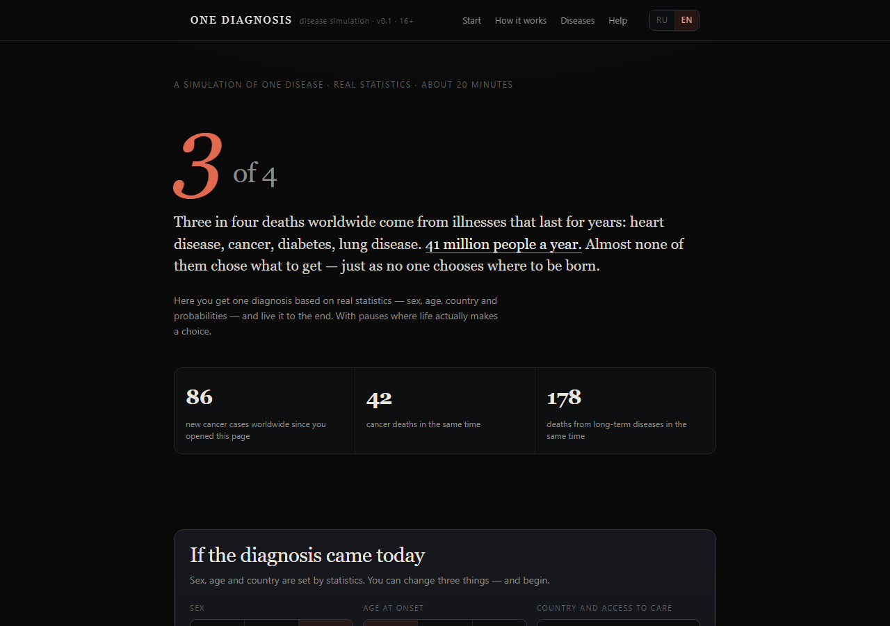
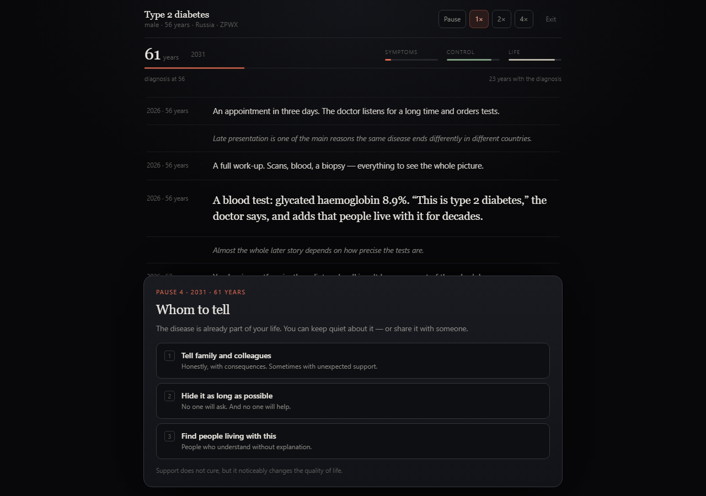
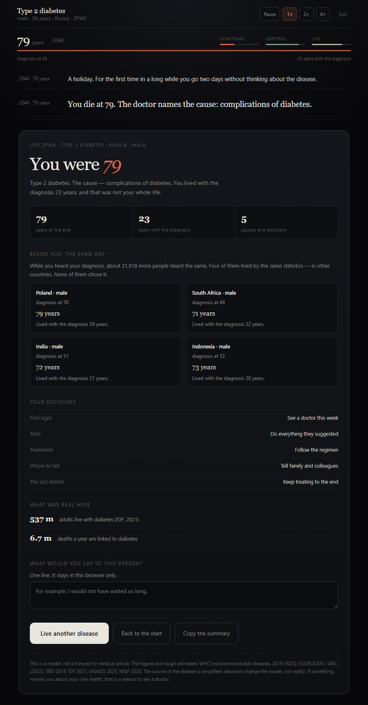
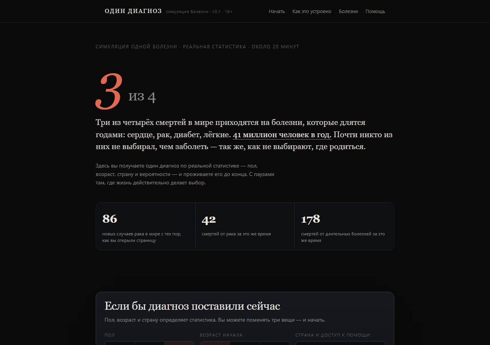
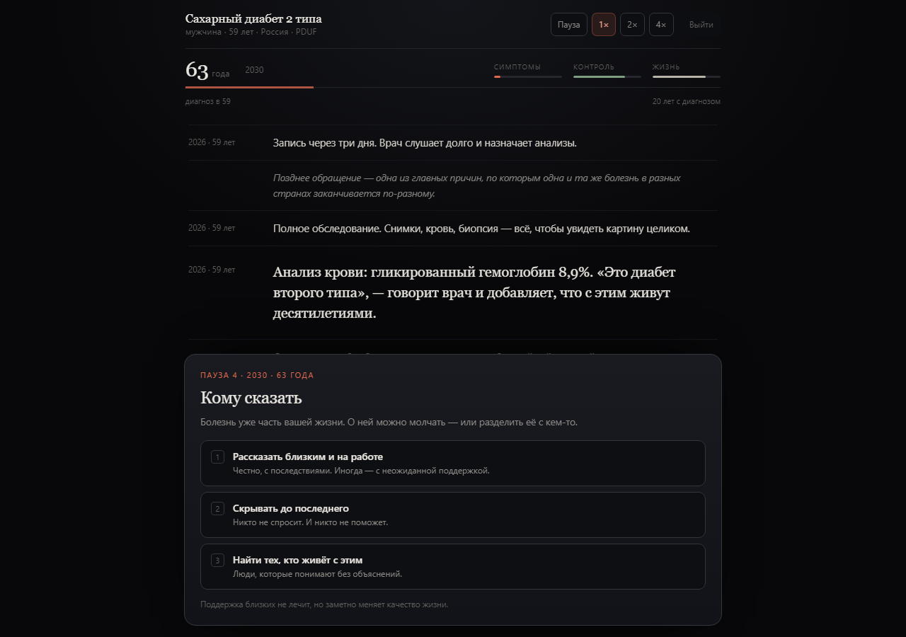
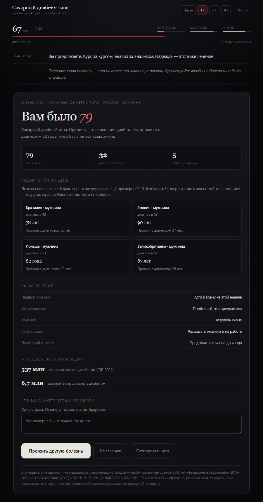

# One Diagnosis

[](https://adrenolitik.github.io/odin-diagnoz/) [](https://adrenolitik.github.io/odin-diagnoz/) [](LICENSE)

A disease simulation: the diagnosis is drawn from real statistics — sex, age at onset and country come from data, not from preferences. You live that life to the end, with pauses where life actually makes a choice. Four similar lives run alongside in other countries: the same diagnosis, different access to care.

The interface and all texts are in Russian and English: switch with **RU / EN** in the header, and the choice is remembered in the browser. There are 17 countries in the list, including Belarus.

**Language:** [Русский](README.md) · English

**Site:** https://adrenolitik.github.io/odin-diagnoz/
**Repository:** https://github.com/adrenolitik/odin-diagnoz
**Version:** 0.1 (beta) · 16+ · a single file, no dependencies, no build step

> This is an educational model, not a forecast and not medical advice. The course of diseases is simplified and the figures are rounded.

---

## Screenshots

### English version



*Home: the statistics, live counters and the start of the setup — after pressing EN in the header.*



*Simulation: age, meters, the life feed and one of the five pauses, with the decision card in English.*



*End: how the life ended, four people with the same diagnosis in other countries, the decisions made and the last line.*

### Русская версия



*Главная: статистика, счётчики в реальном времени и начало настройки.*



*Симуляция: возраст, индикаторы, лента жизни и одна из пяти пауз.*



*Финал: чем закончилась жизнь, четыре человека с тем же диагнозом в других странах, разбор ваших решений и последняя строка.*

The screenshots were taken in Chrome at scale 1: home and simulation at 1280×900, the ending at the height of the card. The Russian and English frames are the same screens; the counter values on the home page are an illustration, not a live reading.

---

## Contents

- [Screenshots](#screenshots)
- [What it is](#what-it-is)
- [How it works](#how-it-works)
  - [Diagnosis](#diagnosis)
  - [Country and access to care](#country-and-access-to-care)
  - [Course of the disease](#course-of-the-disease)
  - [What you see during a life](#what-you-see-during-a-life)
  - [The five pauses](#the-five-pauses)
  - [Four lives alongside](#four-lives-alongside)
  - [The ending](#the-ending)
- [Data](#data)
- [Diseases in the simulation](#diseases-in-the-simulation)
- [Countries and access to care](#countries-and-access-to-care)
- [Running locally](#running-locally)
- [Controls](#controls)
- [File structure](#file-structure)
- [Adding or changing a disease](#adding-or-changing-a-disease)
- [Changing pace and behaviour](#changing-pace-and-behaviour)
- [Safety and ethics](#safety-and-ethics)
- [Limitations](#limitations)
- [Publishing](#publishing)

---

## What it is

The genre is a “life simulation”: you get a random life based on real statistics and live it to the end. In “1 in 8 Billion” you cannot choose where to be born. Here you cannot choose what to fall ill with: almost none of the 41 million people who die every year from long-term diseases chose it either.

One life takes from a few minutes (a short illness) to half an hour (decades with a diagnosis) at 1×: thirty years is about 18 minutes. A life has three layers:

1. **Statistics** — the frequency of the disease, sex, age at onset, country and access to care. This is set before you and barely changes.
2. **Decisions** — five moments where time stops: first symptoms, tests, treatment, family and work, the last stretch. Each changes what comes next, but does not cancel the statistics.
3. **Others** — four people who heard the same diagnosis on the same day, in other countries. Their outcomes are shown in the ending.

The key idea: the difference between life and death with the same disease is usually decided not by willpower but by where a person happened to be and whether they have access to treatment. That is why, in this model, the country matters more than any choice the player makes.

---

## How it works

### Diagnosis

- The disease is chosen by weight: probability = the disease's `weight` / the sum of all weights. Depression and diabetes come up often; cystic fibrosis in about 0.4% of runs.
- Sex comes from the disease's statistics: `only: 'female'` (breast cancer), `skew` — the share of women for diseases that occur in both sexes (for example 0.67 for depression, 0.74 for rheumatoid arthritis).
- Age at onset is a triangular distribution over `onset: [minimum, mode, maximum]`. The “young” and “older” modes shift it towards the lower or upper part of the range.
- The country is chosen by the player (Russia by default) and sets access to care and personal costs.

### Country and access to care

Every country has three parameters:

| Parameter | What it means | How it works |
|---|---|---|
| `access` (0–1) | access to diagnosis and treatment | years lived with the disease, chance of cure, control, probability of a “reasonable” choice in auto mode |
| `oop` (0–1) | share paid out of pocket | how quickly money runs out and debt appears |
| `life` | life expectancy | the upper bound of age |

The model is deliberately crude: these are not national health systems but a single coefficient showing how available care is. It is what creates the main gap in outcomes.

### Course of the disease

Five archetypes (`course`) that set the shape of the severity curve:

| Type | How the disease behaves | Examples |
|---|---|---|
| `progressive` | severity rises monotonically; treatment slows it a little | Parkinson's, Alzheimer's, COPD, cystic fibrosis |
| `relapsing` | flare-ups and remissions, with traces left between them | multiple sclerosis, depression, arthritis, Crohn's, schizophrenia |
| `managed` | almost no progression under good control, damage under poor control | diabetes, HIV, asthma |
| `curable` | there is a chance of cure; if it fails, the disease continues | breast cancer, tuberculosis |
| `acute` | the event happens at once, then survival and consequences | heart attack, stroke |

Formulas (from `Life.update` and `Life.resolve`):

- severity `prog`: `progressive` → `(t/endT)^1.08`; `relapsing` → `t/endT·0.78 + 0.10·sin(1.7t + phase) + 0.06`; `managed` → `t/endT·(1.02 − 0.78·control)`; `acute` → `(t/endT)^0.95`; after a cure → `0.05`;
- control `control` = `0.26 + 0.44·adherence + 0.30·access` when treated, otherwise `0.03 + 0.10·access`;
- quality of life = `88 − 52·severity − 11 (if money is below 25) + 5 (if the person told those close to them) + 4 (if control > 0.55)`;
- lifespan `endT` = the base duration for this level of access × the product of decision multipliers;
- chance of cure = the base probability × `(0.62 + 0.5·adherence)`, minus 25% if the diagnosis was delayed by more than a year.

### What you see during a life

- **The feed** — life events with year and age: symptoms, visits, diagnosis, courses of treatment, side effects, work, money, family, flare-ups, remissions.
- **Three meters** — “Symptoms”, “Control”, “Life”. They move smoothly and show the state, but they are not a game score.
- **The time bar** — how much of the life with the diagnosis has already passed.
- **Age and year** — the current point on the timeline.

### The five pauses

At these points the simulation stops and waits for a decision. Below is what actually changes in the model.

| # | Pause | When | Options | Consequences |
|---|---|---|---|---|
| 1 | First signs | at the start | see a doctor / wait / search the internet | diagnostic delay (0.1–0.3 years against 1.1–2.3), money, quality of life |
| 2 | Tests | after the delay | full / bare minimum / put off | how complete the picture is, cost, duration multiplier 1.07 / 0.98 / 0.90 |
| 3 | Treatment | about six months after diagnosis | follow the regimen / regimen plus folk remedies / refuse | adherence 0.9 / 0.55 / 0.1; multiplier 1.12 / 0.95 / 0.58; chance of cure |
| 4 | Whom to tell | at roughly a quarter of the span | tell / hide / find a community | quality of life ±, costs, adherence |
| 5 | The last stretch | at 70% of the span | keep treating / quality of life / experiment | duration ±7%, quality of life, a 40% chance of luck in a trial |

After a choice, a short remark appears about what the statistics say. At the end there is a sixth, optional pause: one line you would say to this person.

### Four lives alongside

Every simulation also computes four more lives with the same diagnosis and a similar age at onset, but in other countries. Their decisions are made by an automatic policy: the lower the access to care, the more often the visit is postponed, treatment refused and the diagnosis learned late. That is why a life in Nigeria can stand next to your life in Russia and end twenty years earlier — not as a punishment for your choices, but as statistics.

### The ending

The final card contains:

- the age and the cause (or the news of a cure);
- three numbers: age, years with the diagnosis, pauses passed;
- four neighbouring lives with their age and a short outcome;
- a review of every decision you made;
- two real facts about the disease;
- a field for the last line;
- a note that this is a model, and the sources.

Lives you have lived are saved in the browser (`localStorage`, key `od.lives.v1`, up to 24 entries) and shown on the home page under “Lives lived here”. Settings live in `od.settings.v1`, the language in `od.lang.v1`. Nothing is sent to a server.

---

## Data

Rough published estimates, rounded to convenient numbers:

| Source | What was taken |
|---|---|
| WHO, noncommunicable diseases (2019–2023) | 41 million deaths a year, 74% of all deaths, mortality from COPD and diabetes |
| GLOBOCAN / IARC (2022) | 20 million new cancer cases and 9.7 million deaths, 2.3 million breast cancer cases |
| GBD 2019 | strokes (12.2 million), Parkinson's disease (8.5 million), dementia |
| IDF (2021) | 537 million adults with diabetes, 6.7 million related deaths |
| UNAIDS (2023) | 39.9 million people living with HIV, 1.3 million new infections |
| WHO / MSIF / others | tuberculosis (10.8 million), multiple sclerosis (2.8 million), schizophrenia (24 million), depression (280 million), asthma (262 million), arthritis (18 million) |

**What is measured and what is modelled.** Frequencies, age at onset, sex ratios and the general orders of magnitude come from public estimates. The specific lifespan with a disease, the chance of remission and the effect of a decision on the outcome are a model. It is calibrated so that the gaps between countries and diseases look plausible, but it does not reproduce any real patient cohort.

Numbers in the interface are marked as approximate; the site also has a separate paragraph saying this is not medical advice.

---

## Diseases in the simulation

Weight is the relative frequency of being drawn; the percentages are of the sum of weights at version 0.1.

| Disease | Group | Onset, years | Weight | ≈ share | How it usually ends |
|---|---|---|---|---|---|
| Depression | Mind | 14–66 | 150 | 18.2% | relapses; with treatment, a return to life |
| Type 2 diabetes | Metabolism | 26–82 | 130 | 15.8% | decades under control; otherwise vessels, kidneys, feet |
| Coronary heart disease | Heart and vessels | 34–88 | 120 | 14.6% | a stent, a bypass or a heart attack — hours decide |
| Asthma | Lungs | 4–62 | 60 | 7.3% | controllable; deaths are almost always preventable |
| Stroke | Brain and vessels | 32–90 | 55 | 6.7% | survivors often lose speech or movement |
| COPD | Lungs | 40–88 | 55 | 6.7% | slow suffocation with flare-ups |
| Alzheimer's disease | Brain | 56–94 | 45 | 5.5% | a long goodbye; four to thirteen years |
| Breast cancer | Oncology | 32–84 | 40 | 4.9% | usually curable if found early |
| Tuberculosis | Infections | 15–78 | 40 | 4.9% | curable in six months if the course is completed |
| HIV | Infections | 18–50 | 30 | 3.6% | controlled by therapy to near normal |
| Rheumatoid arthritis | Joints | 25–76 | 30 | 3.6% | remissions and deformed joints |
| Parkinson's disease | Brain | 40–88 | 20 | 2.4% | slow movement; dementia in the late stages |
| Schizophrenia | Mind | 16–45 | 18 | 2.2% | relapses; with treatment, a long life |
| Multiple sclerosis | Brain | 18–56 | 15 | 1.8% | relapses and remissions; later, a stick |
| Crohn's disease | Gut | 15–58 | 12 | 1.5% | flare-ups; sometimes surgery |
| Cystic fibrosis | Rare diseases | 1–17 | 3 | 0.4% | treatment every day from birth |

The sum of weights is 823. The disease is drawn afresh on every run.

---

## Countries and access to care

`access` is access to care (0–1), “out of pocket” is the share of personal spending, “life expectancy” is the upper bound of age in the model.

| Country | Access | `access` | Out of pocket | Life expectancy |
|---|---|---|---|---|
| Russia | moderate | 0.63 | 40% | 73 |
| Belarus | moderate | 0.7 | 30% | 74 |
| Germany | high | 0.93 | 12% | 81 |
| USA | high | 0.9 | 92% | 79 |
| United Kingdom | high | 0.87 | 10% | 81 |
| France | high | 0.92 | 10% | 83 |
| Japan | high | 0.95 | 22% | 84 |
| Poland | moderate | 0.76 | 28% | 78 |
| Brazil | moderate | 0.6 | 55% | 76 |
| China | moderate | 0.63 | 55% | 79 |
| India | low | 0.42 | 90% | 71 |
| Indonesia | low | 0.4 | 70% | 72 |
| Mexico | low | 0.55 | 62% | 75 |
| Egypt | low | 0.48 | 75% | 74 |
| Kenya | almost none | 0.3 | 85% | 67 |
| South Africa | low | 0.45 | 75% | 65 |
| Nigeria | almost none | 0.2 | 95% | 55 |

---

## Running locally

No build, no dependencies, no network — a browser is enough.

```bash
# option 1: just open the file
start index.html        # Windows
open index.html         # macOS

# option 2: a local server (if you need http://)
python -m http.server 8000
# then open http://localhost:8000
```

Requirements: any modern browser with ES2017 support. The music uses the Web Audio API and is off unless you turn it on.

---

## Controls

| Action | How |
|---|---|
| Start a life | the “Live this diagnosis” or “Random life” button |
| Pause / resume | the “Pause” button or `Space` |
| Speed | the `1×`, `2×`, `4×` buttons |
| Answer a pause | click an option or press `1`–`3` |
| Leave the simulation | the “Exit” button or `Esc` |
| Auto mode | a checkbox in the setup: every decision is made automatically |
| Remove harsh scenes | a checkbox: softens the wording about death and the ending |
| Quiet music | a checkbox: a quiet synthesised background, no audio files |
| Change language | the `RU` / `EN` buttons in the header; the choice is saved in the browser |

Settings and lived lives stay in the browser. The “Clear” button in the lived lives section removes them.

---

## File structure

Everything is in one `index.html` (about 150 KB). Inside there are four marked sections in one `<script>`.

```
<style>            design: dark theme, serif headings, responsive layout
<body>             markup: hero, setup, “How it works”,
                   disease table, help block, footer, simulation overlay
<script>
  /* 0. LANGUAGE */ L, S(), EN_COUNTRY, EN_DISEASE, GEN_EN — the English layer,
                   UI — the dictionary of static texts, applyLang(), setLang()
  /* 1. DATA */    NOW_YEAR, COUNTRIES, DISEASES, GEN (everyday lines),
                   SOURCES
  /* 2. ENGINE */  utilities, decisionDef(), class Life, runLifeOut()
  /* 3. UI */      settings, tables, counters, start, loop, decisions,
                   end card, localStorage, music
</script>
```

Useful entry points:

- `decisionDef(life, id)` — the texts and options of the five pauses;
- `class Life` — state, progression, event generation, decisions, the ending;
- `Life.advance(dt)` — moves time forward; stops at a pause;
- `Life.policy(id)` — the automatic policy for auto mode and neighbouring lives;
- `runLifeOut(...)` — a fast run of a life without the interface (used for the four neighbours);
- `RATE` — the speed of time in the interface.

---

## Adding or changing a disease

Diseases live in the `DISEASES` array (section `1. DATA`). The fields:

| Field | Purpose | Example |
|---|---|---|
| `id` | identifier | `'breast'` |
| `name` | name | `'Breast cancer'` |
| `group` | group for the table and the interface | `'Oncology'` |
| `only` | one sex only (`'female'`) | `'female'` |
| `skew` | share of women when both sexes are affected | `0.67` |
| `onset` | `[minimum, mode, maximum]` age at onset | `[14, 28, 66]` |
| `weight` | relative frequency of being drawn | `150` |
| `yearly` | new cases worldwide per year (for the “the same day” line) | `20000000` |
| `course` | `progressive` / `relapsing` / `managed` / `curable` / `acute` | `'relapsing'` |
| `years` | `[low, moderate, high access]` — years with the diagnosis | `[8, 25, 45]` |
| `cure` | chance of cure at the same access levels | `[0, 0, 0]` |
| `cost` | relative cost of treatment, 0–1 | `0.30` |
| `delayPenalty` | how much a late visit shortens life | `0.22` |
| `symptoms` | 4 first signs; the first one goes into the question | `['no strength to get up', …]` |
| `treat` | 3 lines about treatment | `['talking therapy', …]` |
| `late` | 3 late complications | `['months in bed', …]` |
| `onsetLine` | the first scene, one paragraph | `'You wake up and…'` |
| `diagLine` | the diagnosis scene | `'The psychiatrist asks questions…'` |
| `beats` | 3 everyday sketches for the middle of the life | `['You learn to notice…', …]` |
| `death` | the cause for the end card | `'complications of diabetes'` |
| `arc` | a short line for the table on the site | `'decades under control'` |
| `tagline` | one literary sentence | `'A disease you can live with…'` |
| `facts` | 2 facts `[big number, explanation]` | `[['537 m', '…']]` |
| `help` | show the help block in the ending | `true` |
| `child` | a disease from childhood: changes the wording | `true` |

A minimal example:

```js
{
  id: 'example', name: 'Example disease', group: 'Group',
  skew: .5, onset: [20, 45, 75], weight: 10, yearly: 1000000,
  course: 'relapsing',
  years: [6, 18, 32], cure: [0, 0, 0], cost: .4, delayPenalty: .2,
  tagline: 'One sentence about what living with this is like.',
  symptoms: ['first', 'second', 'third', 'fourth'],
  treat: ['first', 'second', 'third'],
  late: ['late 1', 'late 2', 'late 3'],
  onsetLine: 'What happens on the first day.',
  diagLine: 'How the diagnosis sounds.',
  beats: ['middle 1', 'middle 2', 'middle 3'],
  death: 'cause of death',
  arc: 'short summary',
  facts: [['number', 'explanation'], ['number', 'explanation']]
}
```

Checks after adding one:

1. Open the site, pick the disease in the list and make sure the texts read without contradictions of sex and age (`child: true` is needed for childhood diseases).
2. Run auto mode 3–5 times: there should be no instant deaths in the first year and no “immortal” lives.
3. Make sure `weight` does not make the disease too frequent: the sum of weights is 823 now, so a weight of 10 is about 1.2%.
4. Check the facts and figures against the primary source and add the source to the table above.

If you add an English version, put its texts in `EN_DISEASE` under the same `id`; otherwise the English interface will show the Russian ones.

---

## Changing pace and behaviour

- **Speed of time** — the `RATE` constant in the UI section: how many years of life pass per real second at 1×. The current value `0.028` gives about 36 seconds per year, and a thirty-year disease about 18 minutes. The `2×` and `4×` buttons multiply it.
- **Acceleration after a cure** — the multiplier `4` in the `sim.advance(...)` call: the three “years after” run quickly.
- **Timing of the pauses** — in `Life.resolve`: “whom to tell” is scheduled at `endT × 0.24` (not earlier than 1.1 years), “the last stretch” at `endT × 0.70` if more than 2.6 years remain.
- **Duration** — `years` in the data and the decision multipliers in `resolve`. The severity curve is `Life.update`.
- **Automatic decisions** — `Life.policy(id)`: the share of “reasonable” choices grows with access to care; for “the last stretch” and “whom to tell” the priorities are their own.
- **Neighbouring lives** — `shadows()` in the UI section: the list of countries, age spread `±7`, seed offset.

---

## Safety and ethics

- A 16+ label and a separate “Hard subjects” section with helplines.
- The simulation contains death, pain, debt and despair — as often as in the statistics, but without detail: methods and scenes are not described.
- The “Remove harsh scenes” checkbox softens the ending and the wording about death.
- For depression and schizophrenia the ending shows a help block (8-800-2000-122 in Russia, findahelpline.com worldwide).
- No analytics, trackers or external requests: the page does not go online.
- This is not a diagnosis and not advice. If something worries you about your own health, that is a reason to see a doctor.

---

## Limitations

- **One disease per life.** Real people live with several conditions at once; there is no comorbidity here.
- **The country is one coefficient.** `access` does not distinguish city from countryside, insurance, queues or the quality of a particular clinic.
- **Duration and remissions are an estimate.** The model does not reproduce any patient cohort; the numbers are plausible but not predictive.
- **Decisions act linearly.** There are no complex interactions, side effects of combinations, or family influence on adherence.
- **Mental illnesses are simplified.** The course of schizophrenia and depression is far more varied in reality, and stigma and access to care change the outcome more than the model shows.
- **The data are rounded** and dated 2019–2023; some estimates are outdated or disputed.
- **Saving is local only.** Lives are not carried between devices and disappear when the browser is cleared.
- **No mobile app and no PWA offline mode** — just the page.

---

## Publishing

The site is served by GitHub Pages from the `main` branch, at the repository root.

- The repository is public: on the free plan Pages only works for public repositories.
- To make a change: edit `index.html`, then

```bash
git add -A
git commit -m "A short description of the change"
git push
```

Pages rebuilds automatically in a minute or two.

If Pages needs to be enabled again:

```bash
gh api -X POST repos/adrenolitik/odin-diagnoz/pages \
  -f "source[branch]=main" -f "source[path]=/"
```

To take the site offline without deleting the code: `gh api -X DELETE repos/adrenolitik/odin-diagnoz/pages`.

Ideas and fixes are welcome through issues in this repository.
